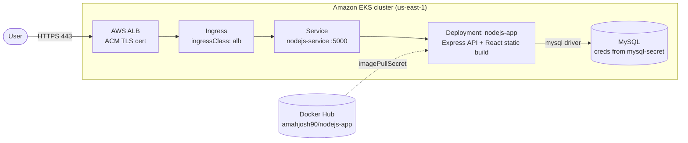
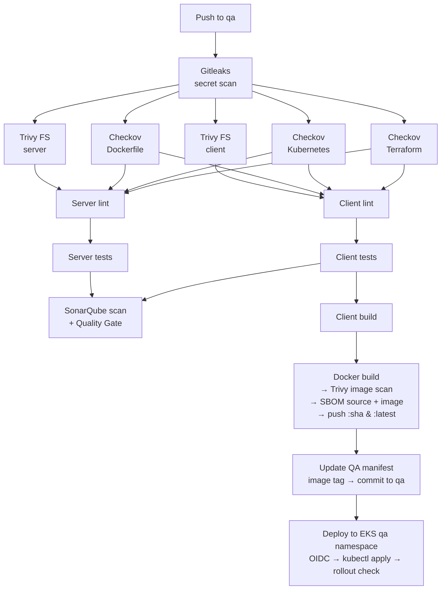
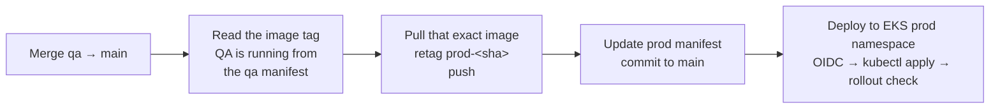

# Complete DevSecOps Pipeline — 3-Tier App on Amazon EKS

An end-to-end **DevSecOps CI/CD pipeline** built with **GitHub Actions** that takes a 3-tier web application (React → Node.js/Express → MySQL) from a `git push` to a running, TLS-terminated deployment on **Amazon EKS**. It runs secret scanning, IaC scanning, dependency and image vulnerability scanning, code-quality gates and SBOM generation, then promotes the same image from **QA** to **Production**.

> The application is a simple user-management CRUD app. It's here as the workload. **The pipeline, security tooling, containerization and Kubernetes delivery are what this project is about.**

---

## Highlights

| Area | What's implemented |
|---|---|
| **Shift-left security** | Gitleaks (secrets), Checkov (Terraform, Kubernetes, Dockerfile), Trivy (filesystem + container image), SonarQube (SAST / code quality + Quality Gate) |
| **Supply chain** | SPDX SBOMs for both the source tree and the built image (Anchore Syft), immutable image tags pinned to the Git commit SHA |
| **Cloud auth** | **GitHub OIDC → AWS IAM role**. No long-lived AWS access keys are stored in GitHub |
| **Environments** | Separate `qa` and `prod` Kubernetes namespaces, each with its own pipeline and its own IAM role |
| **Promotion model** | Build once, promote many: Prod reuses the exact image QA tested, retagged `prod-<sha>`. It's never rebuilt |
| **GitOps-style manifests** | The pipeline writes the new image tag back into the environment's manifest and commits it, so Git always matches what's running |
| **Container hardening** | `node:20-alpine` base, runs as a **non-root** user, production-only dependencies |
| **Ingress & TLS** | AWS Load Balancer Controller (ALB), ACM certificate, forced HTTP → HTTPS redirect |
| **Secrets** | DB credentials come from Kubernetes Secrets; Docker Hub pulls use an `imagePullSecret` |
| **Operability** | Rollout verification (`kubectl rollout status`) plus automatic pod/deployment diagnostics dump when a rollout fails |

---

## Architecture



**Application tiers**

1. **Presentation:** React 17 SPA bundled with Webpack/Babel (`client/`)
2. **Application:** Node.js/Express REST API (`server/`) that also serves the compiled React bundle
3. **Data:** MySQL, with the `users` table created automatically on startup

A single multi-stage-style [Dockerfile](Dockerfile) builds the React client, copies the bundle into the server's `public/` folder and ships one container that listens on port `5000`.

---

## CI/CD Pipeline

### 1. QA: Build, Scan & Deploy ([`.github/workflows/qa-cicd.yml`](.github/workflows/qa-cicd.yml))

Triggered on every push to the **`qa`** branch that touches `client/`, `server/` or the workflow itself.



| Stage | Tooling | Output |
|---|---|---|
| Secret detection | Gitleaks (redacted) | `gitleaks-report.json` artifact |
| IaC / config scanning | Checkov: Terraform, Kubernetes, Dockerfile frameworks | JSON reports per framework |
| Dependency scanning | Trivy filesystem scan on `client/` and `server/` (HIGH/CRITICAL, fixable only) | JSON + table reports |
| Lint & test | Node 18, `npm ci`, lint and test per tier | Job logs |
| SAST & code quality | SonarQube scan + Quality Gate check | SonarQube dashboard |
| Build | Webpack production build, Docker Buildx | Image `amahjosh90/nodejs-app:<git-sha>` |
| Image scanning | Trivy image scan (HIGH/CRITICAL) | JSON + table reports |
| SBOM | Anchore `sbom-action` (SPDX JSON) for source and image | SBOM artifacts |
| Release | Push `:<git-sha>` and `:latest` to Docker Hub | Registry image |
| Manifest update | `sed` new tag into `k8-manifests/qa/app-deployment.yaml`, bot commit with `[skip ci]` | Git commit on `qa` |
| Deploy | OIDC-assumed IAM role → `aws eks update-kubeconfig` → RBAC checks (`kubectl auth can-i`) → `kubectl apply` → `rollout status` | Running pods in `qa` |
| Failure diagnostics | On a failed rollout: `describe` the deployment and pods and pull current/previous container logs | Grouped log output |

Every scan report is uploaded as a **workflow artifact**, so you can review findings for any run.

### 2. Production: Promote & Deploy ([`.github/workflows/prod-cd.yaml`](.github/workflows/prod-cd.yaml))

Triggered when a change to the production deployment manifest (or the workflow) lands on **`main`**, normally by merging a `qa → main` pull request.



The promotion job reads the image tag straight from `k8-manifests/qa/app-deployment.yaml`. That makes **the artifact deployed to production byte-for-byte the one validated in QA**. Nothing gets rebuilt between environments, so there's no drift.

---

## Repository Structure

```
.
├── .github/workflows/
│   ├── qa-cicd.yml            # QA: scan → test → build → scan image → SBOM → push → deploy
│   └── prod-cd.yaml           # Prod: promote QA image → update manifest → deploy
├── client/                    # React 17 front end (Webpack + Babel)
│   ├── src/                   # App.js, components/, api/
│   └── public/                # index.html, compiled bundle, styles
├── server/                    # Node.js / Express API + MySQL access
│   ├── server.js              # Entry point: REST routes, DB init, static hosting
│   ├── config/ models/ controllers/ routes/
├── k8-manifests/
│   ├── qa/                    # Deployment, Service, Ingress for the qa namespace
│   └── prod/                  # Deployment, Service, Ingress for the prod namespace
├── Dockerfile                 # Builds client + server into one non-root image
├── .dockerignore              # Keeps Git, CI, IaC, secrets and docs out of the build context
└── sonar-project.properties   # SonarQube project configuration
```

---

## API

| Method | Endpoint | Description |
|---|---|---|
| `GET` | `/api/users` | List all users |
| `POST` | `/api/users` | Create a user `{ name, email, role }` (`role` is `Admin` or `User`) |
| `PUT` | `/api/users/:id` | Update a user |
| `DELETE` | `/api/users/:id` | Delete a user |
| `GET` | `/*` | Serves the React single-page app |

All SQL queries are parameterized.

---

## Running Locally

**Prerequisites:** Node.js 18+, Docker, and a MySQL instance.

```bash
# 1. Start MySQL
docker run -d --name mysql -p 3306:3306 \
  -e MYSQL_ROOT_PASSWORD=rootpass \
  -e MYSQL_DATABASE=test_db \
  -e MYSQL_USER=appuser \
  -e MYSQL_PASSWORD=password123 \
  mysql:8

# 2. Build and run the app container
docker build -t nodejs-app .
docker run --rm -p 5000:5000 \
  -e DB_HOST=host.docker.internal \
  -e DB_USER=appuser -e DB_PASSWORD=password123 -e DB_NAME=test_db \
  nodejs-app

# 3. Open http://localhost:5000
```

Without Docker: `cd client && npm install && npm run build`, then `cd ../server && npm install && npm start`.

---

## Deploying to Your Own EKS Cluster

**Cluster prerequisites**
- An EKS cluster (the workflows target `my-cluster` in `us-east-1`)
- The [AWS Load Balancer Controller](https://kubernetes-sigs.github.io/aws-load-balancer-controller/) installed
- `qa` and `prod` namespaces, each containing:
  - `mysql-secret` with keys `MYSQL_DATABASE`, `MYSQL_USER`, `MYSQL_PASSWORD`, `DATABASE_URL`
  - `regcred`, a Docker registry pull secret
  - A MySQL service reachable at the hostname `mysql`
- An ACM certificate for your domain (update `certificate-arn` and `host` in `k8-manifests/*/app-ingress.yaml`)
- An IAM OIDC identity provider for GitHub Actions, plus an IAM role per environment that the cluster's access entries / RBAC map to deploy permissions in its namespace

**GitHub configuration**

| Type | Name | Purpose |
|---|---|---|
| Variable | `DOCKERHUB_USERNAME` | Docker Hub login |
| Secret | `DOCKERHUB_TOKEN` | Docker Hub access token |
| Secret | `SONAR_TOKEN` / `SONAR_HOST_URL` | SonarQube server and token |
| Secret | `AWS_ROLE_TO_ASSUME` | IAM role ARN for QA deploys |
| Secret | `AWS_ROLE_TO_ASSUME1` | IAM role ARN for Prod deploys |

---

## Engineering Notes & Lessons Learned

Real issues I hit and fixed while building this pipeline (all visible in the commit history):

- **`ImagePullBackOff` / progress deadline exceeded in QA:** the deploy job was checking out the triggering commit rather than the commit where the bot had just updated the image tag. I fixed it by having the deploy job explicitly check out the latest `qa` ref.
- **Prod pulling a QA image that didn't exist:** the promotion job had been computing the QA tag instead of reading it. It now reads the tag QA is actually running from the QA manifest, which guarantees the image exists and is the tested one.
- **Pipeline loops:** bot commits that update manifests use `[skip ci]`, and the workflows use `paths:` filters so a manifest bump can't re-trigger the build.
- **Least privilege at deploy time:** before applying, each deploy job checks `kubectl auth can-i` for deployments, services and ingresses, which surfaces RBAC problems early and clearly.

## Roadmap

The security scanners currently run in **report mode**: findings are collected as artifacts but don't fail the build. That was deliberate while I baselined the findings. Next steps:

- [ ] Turn on blocking gates (Gitleaks / Trivy `--exit-code 1` on CRITICAL, enforce the SonarQube Quality Gate)
- [ ] Add unit and integration tests and real lint configs (ESLint) for the client and server
- [ ] Sign images with Cosign and verify signatures at admission
- [ ] Add readiness/liveness probes, resource requests/limits and a `securityContext` to the Deployments
- [ ] Move manifests to Helm/Kustomize and deploy via Argo CD for pull-based GitOps
- [ ] Bring the EKS cluster, IAM/OIDC roles and ALB controller into Terraform in this repo
- [ ] Add a manual approval (GitHub Environments) before production deploys

---

## Tech Stack

**CI/CD:** GitHub Actions · **Cloud:** AWS (EKS, IAM OIDC, ALB, ACM) · **Containers:** Docker, Docker Hub, Kubernetes
**Security:** Gitleaks · Checkov · Trivy · SonarQube · Anchore Syft (SBOM)
**App:** React 17 · Webpack · Node.js · Express · MySQL

---

**Author:** Joshua Amah · [GitHub @amahjoshdevsec](https://github.com/amahjoshdevsec)
